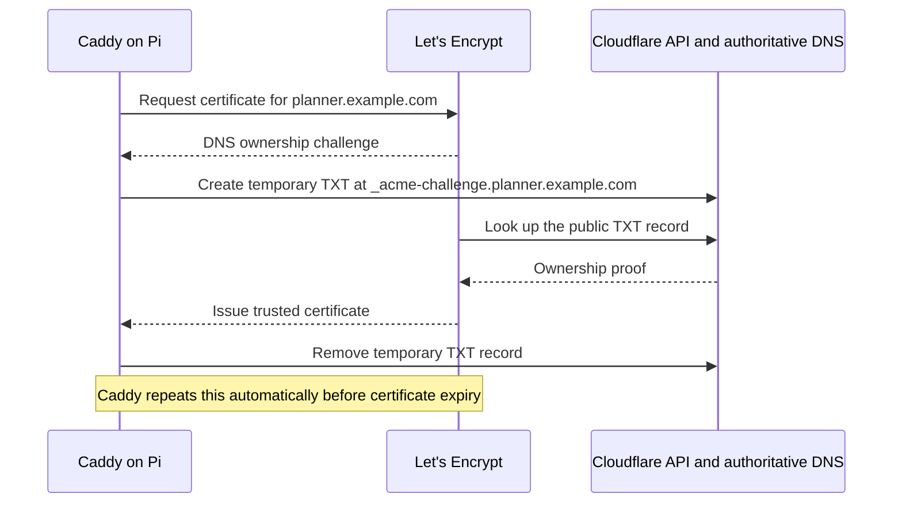

# How the private HTTPS setup works

The planner runs on the Pi and is reachable only through Tailscale. The examples use
`planner.example.com` and `100.64.0.1` for the hostname and the Pi's Tailscale address. Public DNS
publishes its Tailscale address; Cloudflare does not proxy the application's traffic.
The hostname also appears in public certificate transparency logs.

## DNS and a normal request

Configure a Tailscale restricted nameserver for `planner.example.com` pointing to
`1.1.1.1`. This bypasses the home router's DNS resolver for this hostname only.
Home routers with DNS rebinding protection can return NXDOMAIN even though
public resolvers return the correct record. Leave global DNS
override settings unchanged.

The diagram below shows the path after that restricted nameserver is configured.
Browser and OS caches can skip the DNS lookup. The A record's TTL is 300 seconds.

```mermaid
sequenceDiagram
    autonumber
    participant B as Browser on your device
    participant T as Local Tailscale DNS<br/>100.100.100.100
    participant R as Recursive DNS<br/>1.1.1.1
    participant D as Cloudflare authoritative DNS<br/>example.com
    participant C as Caddy on Pi<br/>100.64.0.1:443
    participant A as Planner on Pi<br/>127.0.0.1:8080
    participant P as PostgreSQL on Pi<br/>localhost:5432

    B->>T: OS asks for planner.example.com
    T->>R: Restricted DNS rule forwards this hostname
    opt Answer is not cached
        Note over R,D: Resolver follows DNS delegation if necessary
        R->>D: Query A record for planner.example.com
        D-->>R: 100.64.0.1, TTL 300
    end
    R-->>T: 100.64.0.1
    T-->>B: Return address to the OS/browser

    Note over B,C: HTTPS travels inside the encrypted Tailscale connection<br/>Direct when possible; otherwise a relay carries encrypted packets
    B->>C: TLS handshake for planner.example.com
    C-->>B: Trusted certificate for planner.example.com
    B->>C: HTTPS page or API request
    C->>A: HTTP over Pi loopback
    opt API request needs planner data
        A->>P: Local database query
        P-->>A: Result
    end
    A-->>C: HTML, assets, or JSON
    C-->>B: HTTPS response through Tailscale
    Note over D,C: Cloudflare DNS sees DNS lookups, not planner requests or data
```

Without the restricted nameserver, the local Tailscale DNS forwarder may use the
home router for this hostname. If that router returns NXDOMAIN, the browser never
gets as far as connecting to Caddy.

## Certificate issuance and renewal

This is a separate background flow. The Pi initiates outbound connections; the
certificate authority verifies public DNS rather than connecting to the planner.
The Cloudflare API token is restricted to DNS editing and zone reading for
your zone and is stored in a root-only file on the Pi.



## Access boundaries to verify after deployment

- Caddy's planner listener binds to the Tailscale address on port 443 for TCP and
  UDP, not to a wildcard or LAN address.
- The Rust backend listens only on `127.0.0.1:8080`.
- Any other Caddy listener (such as a public `:80` site) has no route to the planner.
- No Cloudflare Tunnel routes the planner's hostname.
- Tailscale Funnel is not configured for it; no NAT rule forwards to ports 443 or 8080.
- Connections to ports 443 and 8080 on the Pi's LAN address are refused.
- A request over Tailscale with the correct hostname passes normal TLS certificate
  verification and returns `ok` from `/api/health`.

Someone outside the tailnet can look up the DNS name, but that does not give them
a Tailscale route or permission to connect. A device allowed to reach this service
on the tailnet can read and edit the planner; the app has no separate login.

References: [Tailscale DNS](https://tailscale.com/docs/reference/dns-in-tailscale),
[DNS rebinding protection](https://tailscale.com/docs/reference/faq/dns-rebinding),
[Caddy DNS challenges](https://caddyserver.com/docs/automatic-https#dns-challenge).
